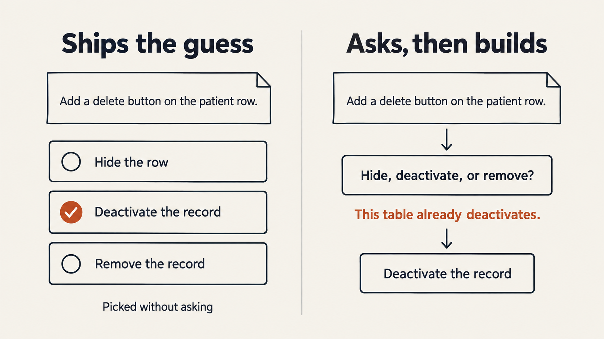
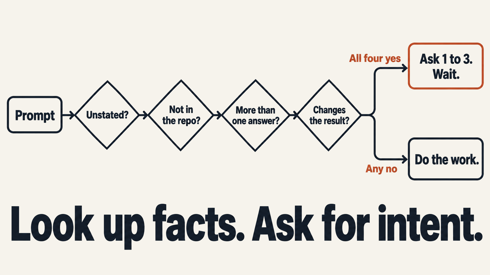

# karpathy-skills-extended

Coding agents often fill in missing details and keep going. That is usually efficient, until the missing detail is actually a decision. For example, "Add a delete button on the patient row" could mean hiding the row, marking the record inactive, or permanently removing it. The agent might pick one interpretation, write the code, and open a PR before you realize there was a choice to make.

In his [notes on LLM coding mistakes](https://x.com/karpathy/status/2015883857489522876), Andrej Karpathy describes how models make assumptions and then act on them. The [Karpathy guidelines](https://github.com/multica-ai/andrej-karpathy-skills) encourage agents to make those assumptions visible, explain tradeoffs, and ask when they are unsure. That is a good start, but stating an assumption is not the same as giving you a chance to decide before the code changes.

Matt Pocock's [grill-me](https://github.com/mattpocock/skills/blob/main/skills/productivity/grill-me/SKILL.md) skill, and the [grilling](https://github.com/mattpocock/skills) session under it, take a more thorough approach. They work through the different branches of a plan and keep going until the important assumptions have been settled. This is especially useful when you are still working out what you want to build. But when your prompt already describes a concrete task, that much discussion can slow things down.

This skill takes a middle ground. It keeps Karpathy's coding rules and adds a quick check for missing information that could change the result. Before coding, the agent checks whether the answer is already available in the repository, documentation, tools, or conversation. It asks only when several interpretations are reasonable and choosing between them would make a meaningful difference. The agent asks its questions in one round, explains what it would otherwise have chosen, and asks no more than three questions. If nothing important is left unresolved, it simply gets on with the work.



## The gap check

The agent asks a question only when all four conditions are met:

1. You have not specified the answer, and no earlier turn has settled it.
2. The agent cannot find the answer in the repository, documentation, tools, or configuration.
3. More than one reasonable interpretation exists.
4. Choosing between those interpretations would change the files, behavior, audience, schema, copy, or definition of done.

If even one condition is not met, the agent does not interrupt you. It looks up the answer or follows the interpretation best supported by your request and the surrounding code. Finding information is the agent's job; deciding what you want is yours.



## Coding rules

The skill includes the four Karpathy rules, so you can use them without installing the original separately:

- **Think before coding.** Consider the tradeoffs when they could affect the design. Prefer the simpler approach when it fits, and explain why.
- **Simplicity first.** Build what the request needs. Avoid extra features, unnecessary abstractions, and configuration you did not ask for.
- **Surgical changes.** Change only what the task requires and follow the conventions of the existing file. Leave unrelated dead code alone, but mention it if you notice it.
- **Goal-driven execution.** Turn the request into a check you can run, then run it.

When an unresolved decision could materially change the result, the gap check takes priority over the usual advice to state an assumption and proceed.

## Install

The skill's instructions live in [`skills/karpathy-skills-extended/SKILL.md`](skills/karpathy-skills-extended/SKILL.md). Codex, Claude, Cursor, Antigravity, Gemini, and Grok all use this Agent Skills layout.

To install it, copy the skill folder into the host's skills directory, then copy [`rules/karpathy-skills-extended.md`](rules/karpathy-skills-extended.md) into the host's always-on instructions. The skills directory lets the agent load the full skill when it is relevant and provides the `/karpathy-skills-extended` command. The always-on file serves a different purpose: it keeps the gap check in the instructions on every prompt, including in hosts that do not load the full skill until they decide it applies.

```bash
npx skills add anshuxinha/karpathy-skills-extended
```

To install for a particular host, pass `-a` followed by the installer name: `codex`, `claude-code`, `cursor`, `antigravity`, `antigravity-cli`, `gemini-cli`, or `grok`. For example:

```bash
npx skills add anshuxinha/karpathy-skills-extended -a codex
```

| Host | Skill folder | Always-on file |
| --- | --- | --- |
| Codex | `~/.codex/skills/` and `<repo>/.agents/skills/` | `~/.codex/AGENTS.md` |
| Claude Code | `~/.claude/skills/` | `~/.claude/rules/` or `~/.claude/CLAUDE.md` |
| Cursor | `~/.cursor/skills/` and `<repo>/.agents/skills/` | [`.cursor/rules/karpathy-skills-extended.mdc`](.cursor/rules/karpathy-skills-extended.mdc) copied to `~/.cursor/rules/` (`alwaysApply: true`) |
| Antigravity | `~/.gemini/config/skills/`, `~/.gemini/antigravity/skills/`, `~/.gemini/antigravity-cli/skills/`, and `<repo>/.agents/skills/` | `AGENTS.md` in the project |
| Gemini CLI | `~/.gemini/skills/` and `<repo>/.agents/skills/` | `GEMINI.md` |
| Grok | `~/.grok/skills/` and `~/.agents/skills/` | `~/.grok/rules/` |

Those paths are the ones the [skills installer](https://github.com/vercel-labs/skills) and each host's docs use. Codex also reads `agents/openai.yaml` inside the skill for its skill picker.

Installing the plugin adds the slash command on that host. The always-on file is still the copy that loads the check every session.

```bash
grok plugin install anshuxinha/karpathy-skills-extended --trust
agy plugin install https://github.com/anshuxinha/karpathy-skills-extended
```

## Examples

"Add a delete button on the patient row." The word "delete" could mean hiding the row, marking the record inactive, or removing it. The agent checks how the rest of the table handles deletion, recommends the matching behavior, and asks you to settle the choice before making the change.

"Rename getUser to fetchUser in src/api.ts." The request is clear enough to act on, so the agent renames the function without asking an unnecessary question.

## License

MIT. The four coding rules follow the structure of [multica-ai/andrej-karpathy-skills](https://github.com/multica-ai/andrej-karpathy-skills). Stopping to ask you, when a decision is still open, follows Matt Pocock's grill-me. The wording in this repo is ours. See [NOTICE](NOTICE).
